<picture>
  <source media="(prefers-color-scheme: dark)" srcset="assets/header-dark.svg">
  
</picture>

These days I mostly work on LLM agents and the backend code around them, currently at University Lands / UT System. Before that I did research on LLMs for security at UT Arlington's Cyber Guard Research Lab and interned at Velric.ai.

I graduated from UT Arlington in 2026. Outside of work I go to hackathons and now and then send a PR to an open-source project.

[rabib-husain.netlify.app](https://rabib-husain.netlify.app/) · [LinkedIn](https://www.linkedin.com/in/rabib-husain/)

#### Some things I've built

  <a href="https://github.com/Rabib001/relay"><picture><source media="(prefers-color-scheme: dark)" srcset="assets/cards/relay-dark.svg"></picture></a>
  <a href="https://github.com/Rabib001/HackUTD_2025"><picture><source media="(prefers-color-scheme: dark)" srcset="assets/cards/autoboard-dark.svg"></picture></a>
  <a href="https://github.com/Rabib001/waste.0"><picture><source media="(prefers-color-scheme: dark)" srcset="assets/cards/waste0-dark.svg"></picture></a>

#### Tools I use

  

