<a href="https://rabib-husain.netlify.app/"></a>

<p align="center">
  <a href="https://rabib-husain.netlify.app/"></a>
  <a href="https://www.linkedin.com/in/rabib-husain/"></a>
  
</p>


### `> whoami`

I'm the **founding engineer at [Spaceodd](https://spaceodd.com)**, where I own the backend and infrastructure for an AI film pre-production platform: atomic credit transactions, idempotent Stripe webhooks, and a hardened production edge.
I'm also an **ML/LLM intern at University Lands / UT System**. Eight developers use the multi-agent orchestrator I built there to work Azure DevOps stories, with adversarial code review and each job in its own Docker workspace.

Before that I did LLM-for-security research at the **Cyber Guard Research Lab** (LLMs that turn vulnerability reports into proof-of-concept exploits, checked in sandboxes) and row-level-security work at **Velric.ai**. I graduated from UT Arlington with an Honors CS degree in May 2026 and live in Austin.

```diff
+ shipping   backend + infra for an AI film studio tool
+ building   agents that review other agents' code
+ open src   secret-detection rules for betterleaks
- not        a fan of webhooks that grant credits twice
```



### `> ls ~/projects --best`

<p align="center">
  <a href="https://github.com/Rabib001/relay"></a>
  <a href="https://github.com/Rabib001/HackUTD_2025"></a>
  <a href="https://github.com/Rabib001/Fine-tuned_SAM"></a>
  <a href="https://github.com/Rabib001/FleetPulse"></a>
  <a href="https://github.com/Rabib001/waste.0"></a>
  <a href="https://github.com/Rabib001/legalAI"></a>
</p>

### `> cat toolbox.txt`

<p align="center">
  
</p>


